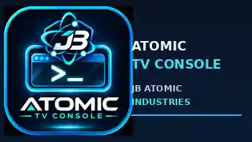

# ATOMIC TV Console
### ADB commands, Android TV diagnostics and remote management from a PC or phone

**Android TV / Google TV app · 118 commands · 11 workflows · Local web dashboard**

[Français](README.md) · [English](README.en.md) · [Español](README.es.md) · [Русский](README.ru.md)

[**Download signed Android TV APK**](https://github.com/ElecktroSkwiiZz/atomic-tv-console/releases/latest) · [Official releases](https://github.com/ElecktroSkwiiZz/atomic-tv-console/releases) · [JB Atomic Industries](https://jbatomic.com/)

## Overview

**ATOMIC TV Console** is an Android TV / Google TV ADB command manager and diagnostic application developed by **JB Atomic Industries**. It provides a searchable catalog, guided command workflows and a local browser dashboard for computers and smartphones.

## Key features

- **118 ADB commands** across system, display, networking, HDMI/audio, storage, apps and diagnostics.
- **11 workflows** for system status, performance, HDMI/eARC, network, storage, animation settings and temporary caches.
- **Local PC / mobile dashboard** with command search, an ADB shell terminal, history and downloadable TXT reports.
- **Remote-control friendly Android TV UI**, with French/English selection and confirmation dialogs.
- **Manual reversible disabling of selected preinstalled apps**, never an automatic bulk uninstall.
- **Signed GitHub Releases** and Android signing-certificate checks for updates.
- Configurable web port (**8767 by default**) with fallback to another available port, and a **4-digit PIN**.

## Download & setup

**Current published version: v1.2.1.** [Download the official signed APK](https://github.com/ElecktroSkwiiZz/atomic-tv-console/releases/latest).

1. Install the signed APK on an Android TV / Google TV device running Android 11 or later.
2. Enable and authorize **legacy TCP ADB** on the TV beforehand, if supported by its firmware.
3. In the application, test localhost ADB (`127.0.0.1:5555` by default).
4. Use the TV workflows or enable the optional LAN dashboard from the TV.

Open the address shown on the TV from a computer or smartphone on the **same trusted LAN**, enter the four-digit PIN, and access the command catalog, workflows, terminal and TXT export.

**Compatibility:** Android 11+ (API 30+). The current client does **not** support modern TLS wireless-debugging pairing. Commands cannot bypass Android permissions or device manufacturer restrictions.

## Security and limitations

The LAN portal is **disabled by default**, uses **unencrypted local HTTP**, and must **never** be exposed through router port forwarding or used on an untrusted network. The four-digit PIN is supported by login-attempt throttling and session controls, but a trusted LAN remains essential. Terminal commands may change or erase data; review each command before running it. Animation settings cannot improve external HDMI console FPS.

## FAQ

**Can I control my Android TV from a phone?** Yes, through the optional PIN-protected LAN web dashboard.

**Can I export ADB diagnostic results?** Yes, copy text or download a TXT file in the browser.

**Does it require root?** No, but it does require an authorized legacy TCP ADB endpoint; some commands need permissions that may be unavailable.

**Can it debloat a TV automatically?** No. Optional packages must be reviewed and selected manually, and disable actions can affect vendor features.

## Project details

**Package:** `com.jbatomic.tvconsole` · **Build:** JDK 17 / Android SDK 35 / Gradle 8.10.2 (`gradle --no-daemon assembleDebug`).

[Changelog](CHANGELOG.md) · [Security](SECURITY.md) · [Public APK certificate fingerprint](SIGNATURE_PUBLIQUE.txt) · [Third-party notices](THIRD_PARTY_NOTICES.md) · [ATOMIC TV Capture](https://github.com/ElecktroSkwiiZz/atomic-tv-capture).

© 2026 [JB Atomic Industries](https://jbatomic.com/). Source availability does not imply permission to redistribute or reuse without an applicable license.
