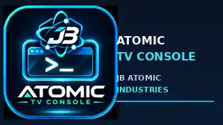

# ATOMIC TV Console
### Comandos ADB, diagnóstico de Android TV y control desde PC o móvil

**Android TV / Google TV · 118 comandos · 11 tareas agrupadas · Panel web local**

[Français](README.md) · [English](README.en.md) · [Español](README.es.md) · [Русский](README.ru.md)

[**Descargar APK oficial firmada**](https://github.com/ElecktroSkwiiZz/atomic-tv-console/releases/latest) · [Versiones oficiales](https://github.com/ElecktroSkwiiZz/atomic-tv-console/releases) · [JB Atomic Industries](https://jbatomic.com/)

## Descripción

**ATOMIC TV Console**, de **JB Atomic Industries**, permite consultar y ejecutar comandos ADB en Android TV y Google TV mediante el mando a distancia o un navegador web de la red local.

## Funciones principales

- **118 comandos ADB** organizados por sistema, pantalla, red, HDMI/audio, aplicaciones, almacenamiento y diagnóstico.
- **11 tareas agrupadas** para analizar el rendimiento, la memoria, la red, el audio y los ajustes de animación.
- **Panel web para ordenador, móvil o tableta** con búsqueda, terminal `adb shell`, historial y descarga de resultados TXT.
- **Interfaz de televisión** adaptada al mando, con selector francés/inglés.
- **Gestión manual y reversible de aplicaciones preinstaladas**: no se desinstalan paquetes automáticamente.
- **Actualizaciones oficiales firmadas**, distribuidas mediante GitHub Releases.
- **PIN de cuatro dígitos** y **puerto web configurable** (8767 por defecto, con selección automática de otro si está ocupado).

## Instalación

[Descargar la última APK firmada — v1.2.1](https://github.com/ElecktroSkwiiZz/atomic-tv-console/releases/latest). Instálala en Android TV / Google TV **Android 11 o posterior**, activa y autoriza previamente **ADB por TCP** si tu dispositivo lo permite y comprueba la conexión local (`127.0.0.1:5555` por defecto).

Para controlar la televisión desde otro dispositivo, activa el portal web en la TV, abre en el navegador la dirección local que aparece en pantalla e introduce el PIN de cuatro dígitos. Es necesario que ambos dispositivos estén en la **misma red privada de confianza**.

**Importante:** el portal utiliza **HTTP local sin cifrar**. No abras su puerto a Internet. La aplicación no concede permisos root ni admite el emparejamiento ADB inalámbrico moderno mediante TLS; algunas operaciones dependen del fabricante. Las opciones de animación no aumentan los FPS de una consola HDMI externa.

## Preguntas frecuentes

**¿Puedo controlar Android TV desde el móvil?** Sí, con el portal local activado.

**¿Puedo exportar resultados?** Sí, es posible copiarlos o descargarlos en TXT.

**¿Borra automáticamente aplicaciones del sistema?** No. La selección y desactivación son manuales y pueden afectar a funciones del fabricante.

## Proyecto

Paquete: `com.jbatomic.tvconsole`. Compilación: Java 17, Android SDK 35 y Gradle 8.10.2.

[Historial](CHANGELOG.md) · [Seguridad](SECURITY.md) · [ATOMIC TV Capture](https://github.com/ElecktroSkwiiZz/atomic-tv-capture).

© 2026 [JB Atomic Industries](https://jbatomic.com/). El código y los recursos están sujetos a sus avisos de derechos.
