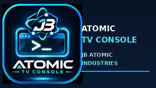

# ATOMIC TV Console
### ADB-команды, диагностика Android TV и управление с компьютера или смартфона

**Android TV / Google TV · 118 команд · 11 сценариев · Локальная веб-панель**

[Français](README.md) · [English](README.en.md) · [Español](README.es.md) · [Русский](README.ru.md)

[**Скачать официальную подписанную APK**](https://github.com/ElecktroSkwiiZz/atomic-tv-console/releases/latest) · [Релизы](https://github.com/ElecktroSkwiiZz/atomic-tv-console/releases) · [JB Atomic Industries](https://jbatomic.com/)

## О приложении

**ATOMIC TV Console** от **JB Atomic Industries** — приложение для Android TV и Google TV, позволяющее запускать ADB-команды с пульта телевизора или через браузер на устройстве в локальной сети.

## Возможности

- **118 ADB-команд** для диагностики системы, экрана, сети, HDMI/звука, памяти и приложений.
- **11 готовых сценариев** для анализа производительности, сети, HDMI/eARC, хранилища и настроек анимации.
- **Веб-панель для ПК и смартфона**: поиск, терминал `adb shell`, история и скачивание отчётов TXT.
- Интерфейс для телевизора с управлением пультом и переключением французского/английского языков.
- Ручное обратимое отключение выбранных предустановленных приложений **без автоматического удаления**.
- Обновления через официальные подписанные GitHub Releases.
- Четырёхзначный PIN и настраиваемый веб-порт (по умолчанию 8767, с подбором свободного порта).

## Установка

[Скачать последнюю подписанную APK — v1.2.1](https://github.com/ElecktroSkwiiZz/atomic-tv-console/releases/latest). Требуется Android TV / Google TV с **Android 11 или новее**. Сначала включите и авторизуйте **классический ADB через TCP**, если это поддерживает прошивка, затем проверьте подключение к `127.0.0.1:5555` в приложении.

Для управления с ПК или телефона включите веб-панель на телевизоре. Откройте показанный локальный адрес в браузере другого устройства в **той же доверенной сети** и введите четырёхзначный PIN.

**Безопасность:** веб-панель использует **незашифрованный локальный HTTP**. Не открывайте её порт в Интернет. Приложение не предоставляет root-доступ и не поддерживает современное TLS-сопряжение беспроводной отладки Android. Доступность команд зависит от производителя. Настройки анимации не увеличивают FPS внешней консоли через HDMI.

## Вопросы

**Можно ли управлять телевизором со смартфона?** Да, через включённую локальную веб-панель.

**Можно ли сохранить результаты диагностики?** Да, скопировать текст или скачать файл TXT.

**Удаляет ли приложение системные программы автоматически?** Нет, возможен только ручной выбор и отключение с подтверждением.

## Проект

Пакет: `com.jbatomic.tvconsole`. Сборка: JDK 17, Android SDK 35, Gradle 8.10.2.

[История версий](CHANGELOG.md) · [Безопасность](SECURITY.md) · [ATOMIC TV Capture](https://github.com/ElecktroSkwiiZz/atomic-tv-capture).

© 2026 [JB Atomic Industries](https://jbatomic.com/). Использование исходного кода и графики регулируется условиями правообладателя.
